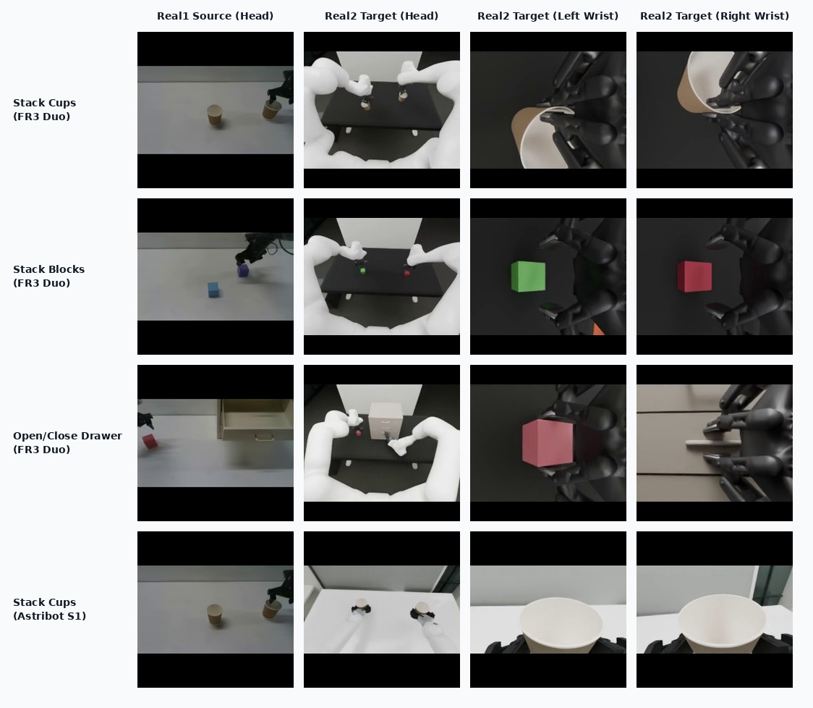

<p align="center">
  <picture>
    <source media="(prefers-color-scheme: dark)" srcset="docs/assets/logo_banner_dark.png" />
    
  </picture>
</p>

<h2 align="center">ReEmbody: Cross-Embodiment Data Reuse for Real-World Robot Learning</h2>

<p align="center">
  <b>Yichen Liu</b>, Guodong Lv, Yintianrun Zhang, Quanwei Zhang, Shilong Li, Hongyu Zhang,<br/>
  Kewei Zhang, Zhengzhe Chen, Jiaming Liu, Leixing Wang, Feixiang Ruan, <b>Daquan Zhou<sup>†</sup></b><br/>
  Peking University &nbsp;·&nbsp; <sup>†</sup>Corresponding Author
</p>

<p align="center">
  <b>| <a href="https://dagroup-pku.github.io/ReEmbody.github.io/">Project Page</a> | <a href="docs/PIPELINE.md">Pipeline</a> | <a href="examples/README.md">Examples</a> |</b>
</p>

<p align="center">
  
</p>

**ReEmbody** converts real-world source robot demonstrations (`Real1`, AgileX COBOT-Magic) into target-embodiment actions and synchronized 3-view observations (`Real2`) for real **Dual-Arm Franka FR3** and **Astribot S1** robots via a four-stage data pipeline (`Real1 → Sim1 → Sim2 → Real2`).

This repository provides the complete real-world data pipeline and four end-to-end examples in standard **LeRobot v2.1** format (excluding downstream $\pi_{0.5}$ policy training).

---

## Pipeline

| Stage | Directory | Description |
| :--- | :--- | :--- |
| **1. Real1 → Sim1** | [`stages/01_real1_to_sim1`](stages/01_real1_to_sim1) | 3-view scene reconstruction, contact/timing replay, task contract binding |
| **2. Sim1 → Sim2** | [`stages/02_sim1_to_sim2`](stages/02_sim1_to_sim2) | Target embodiment setup (FR3 Duo / Astribot S1), controllers & LLM revision loop |
| **3. Sim2 → Refine** | [`stages/03_sim2_refine`](stages/03_sim2_refine) | Placement augmentation, trajectory refinement, clearance & replay admission |
| **4. Sim2 → Real2** | [`stages/04_sim2_to_real2`](stages/04_sim2_to_real2) | Blender Cycles 3-view rendering (`224×224`, 30 fps) & LeRobot v2.1 packaging |

---

## Real-World Examples

<p align="center">
  
</p>

| Example | Task | Target Robot | Output |
| :--- | :--- | :--- | :--- |
| [`examples/stack_cups_fr3_ep000`](examples/stack_cups_fr3_ep000) | Stack Cups | Dual-Arm Franka FR3 | 519 frames, 16-D state/action, 3× MP4 |
| [`examples/stack_blocks_fr3_ep000`](examples/stack_blocks_fr3_ep000) | Stack Blocks | Dual-Arm Franka FR3 | 523 frames, 16-D state/action, 3× MP4 |
| [`examples/drawer_fr3_ep000`](examples/drawer_fr3_ep000) | Open / Insert / Close Drawer | Dual-Arm Franka FR3 | 470 frames, 16-D state/action, 3× MP4 |
| [`examples/stack_cups_s1_ep000`](examples/stack_cups_s1_ep000) | Stack Cups | Astribot S1 | 450 frames, 32-D state / 22-D action, 3× MP4 |

Each example contains `01_real1_source/`, `02_sim1_reconstructed/`, `03_sim2_target/`, and `04_real2_rendered/lerobot_v2_1/`.

---

## Quick Start

```bash
# 1. Install physics & verification environment (Python 3.11)
pip install -r requirements/physics.txt && pip install -e .

# 2. Verify all bundled examples (no external downloads required)
python scripts/verify_examples.py

# 3. Fetch pinned FR3 / Robotiq meshes and verify live MuJoCo 3.3.7 scenes
bash scripts/setup_third_party_assets.sh
python scripts/verify_examples.py --check-mujoco

# 4. Export a Sim2 example to Blender and render a preview (requires bpy 4.5 LTS)
python scripts/run_example_pipeline.py --example stack_cups_fr3_ep000 --mode export-blender --out outputs/demo
REEMBODY_BLENDER_PYTHON=/path/to/bpy-python \
python scripts/run_example_pipeline.py --example stack_cups_fr3_ep000 --mode render-preview --out outputs/demo --device CPU
```

See [`docs/PIPELINE.md`](docs/PIPELINE.md) for stage commands and [`docs/ASSETS.md`](docs/ASSETS.md) for environment variables.

---

## Citation

```bibtex
@article{liu2026reembody,
  title   = {ReEmbody: Cross-Embodiment Data Reuse for Real-World Robot Learning},
  author  = {Liu, Yichen and Lv, Guodong and Zhang, Yintianrun and Zhang, Quanwei and
             Li, Shilong and Zhang, Hongyu and Zhang, Kewei and Chen, Zhengzhe and
             Liu, Jiaming and Wang, Leixing and Ruan, Feixiang and Zhou, Daquan},
  journal = {arXiv preprint},
  year    = {2026}
}
```
