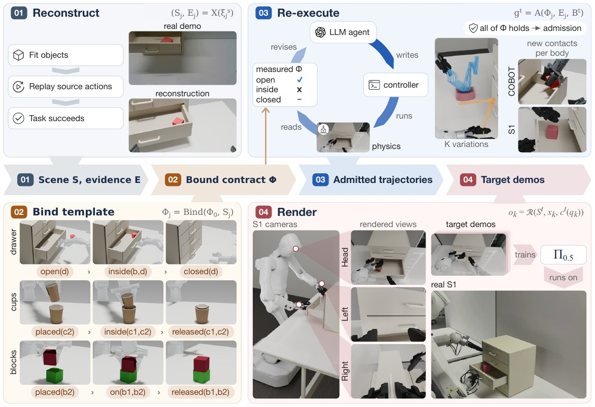

<p align="center">
  
</p>

<h1 align="center">ReEmbody: Cross-Embodiment Data Reuse for Real-World Robot Learning</h1>

<p align="center">
  <b>Yichen Liu</b>, Guodong Lv, Yintianrun Zhang, Quanwei Zhang, Shilong Li, Hongyu Zhang,<br/>
  Kewei Zhang, Zhengzhe Chen, Jiaming Liu, Leixing Wang, Feixiang Ruan, <b>Daquan Zhou<sup>†</sup></b>
  <br/>
  Peking University &nbsp;·&nbsp; <sup>†</sup>Corresponding Author
</p>

<p align="center">
  <a href="https://dagroup-pku.github.io/ReEmbody.github.io/">
    
  </a>
  <a href="https://dagroup-pku.github.io/ReEmbody.github.io/assets/ReEmbody-paper.pdf">
    
  </a>
  <a href="LICENSE">
    
  </a>
</p>

<p align="center">
  
</p>

> **Release Scope:** This repository open-sources the **ReEmbody cross-embodiment data construction pipeline (`Real1 → Sim1 → Sim2 → Real2`)** together with four complete end-to-end examples (spanning all three real-world manipulation tasks and two target robot embodiments: **Dual-Arm Franka FR3** and **Astribot S1**). Downstream $\pi_{0.5}$ policy training environments and checkpoints are intentionally excluded; every generated dataset is exported directly in standard **LeRobot v2.1** format so it can be consumed by any policy learning stack.

---

## Overview

Robot demonstrations encode actions and camera views tied to the body that recorded them. **ReEmbody** converts recorded source demonstrations (`Real1`, e.g., dual-arm AgileX COBOT-Magic) into target-specific action labels and synchronized moving-camera observations (`Real2`) for a new target robot (e.g., **Dual-Arm Franka FR3 + Robotiq 2F-85** or **Astribot S1**) through four explicit, verifiable stages:

| Stage | Directory | Paper Phase | Input → Output |
| :--- | :--- | :--- | :--- |
| **Stage 1: Real1 → Sim1** | [`stages/01_real1_to_sim1`](stages/01_real1_to_sim1) | **01 Reconstruct** & **02 Bind template** | Source 3-view videos + states → Reconstructed MuJoCo scene $S_j$, replayed contact/timing evidence $E_j$, bound relation contract $\Phi_j$ |
| **Stage 2: Sim1 → Sim2** | [`stages/02_sim1_to_sim2`](stages/02_sim1_to_sim2) | **03 Re-execute** | Bound contract $\Phi_j$, target robot $B^t$, execution API → Target controllers (rule + LLM-guided revision loop) & native MuJoCo rollouts |
| **Stage 3: Sim2 → Refine** | [`stages/03_sim2_refine`](stages/03_sim2_refine) | **03 Verify & Admit** | Target rollouts → Placement augmentation, trajectory refinement, clearance/physical/contract gates, and bit-exact independent replay admission |
| **Stage 4: Sim2 → Real2** | [`stages/04_sim2_to_real2`](stages/04_sim2_to_real2) | **04 Render** | Admitted trajectories + calibrated target workspace $S^t$ → Synchronized 3-view Blender Cycles renders (`224×224`, 30 fps) packaged as **LeRobot v2.1** |

---

## Bundled End-to-End Examples

Four complete `Real1 → Sim1 → Sim2 → Real2` examples are bundled directly under [`examples/`](examples/README.md):

<p align="center">
  
</p>

| Example | Task | Source → Target Embodiment | Target Frames / Duration | Output Format |
| :--- | :--- | :--- | :---: | :--- |
| [`examples/stack_cups_fr3_ep000`](examples/stack_cups_fr3_ep000) | Stack Cups | COBOT-Magic → **Dual-Arm Franka FR3** | 519 frames (17.3 s) | 16-D state/action + 3× `224×224` MP4 (LeRobot v2.1) |
| [`examples/stack_blocks_fr3_ep000`](examples/stack_blocks_fr3_ep000) | Stack Blocks | COBOT-Magic → **Dual-Arm Franka FR3** | 523 frames (17.4 s) | 16-D state/action + 3× `224×224` MP4 (LeRobot v2.1) |
| [`examples/drawer_fr3_ep000`](examples/drawer_fr3_ep000) | Open / Insert / Close Drawer | COBOT-Magic → **Dual-Arm Franka FR3** | 470 frames (15.7 s) | 16-D state/action + 3× `224×224` MP4 (LeRobot v2.1) |
| [`examples/stack_cups_s1_ep000`](examples/stack_cups_s1_ep000) | Stack Cups | COBOT-Magic → **Astribot S1** | 450 frames (15.0 s) | 32-D state / 22-D action + 3× `224×224` MP4 (LeRobot v2.1) |

Each example folder contains all four stages cleanly separated:
- `01_real1_source/` — recorded source COBOT-Magic parquet trajectory and 3 camera MP4s
- `02_sim1_reconstructed/` — reconstructed Sim1 MuJoCo scene, fitted object geometry, and source replay arrays
- `03_sim2_target/` — portable target `scene.xml`, controller, admitted MuJoCo `episode.npz`, and verification receipt
- `04_real2_rendered/` — Blender Cycles render receipt, start/end keyframes, and a self-contained single-episode **LeRobot v2.1** dataset

---

## Repository Structure

```text
ReEmbody/
├── reembody/                    # Portable path & environment resolution utilities
├── stages/
│   ├── 01_real1_to_sim1/        # Three-view source reconstruction, prompts, schemas
│   ├── 02_sim1_to_sim2/         # Dual-Arm FR3 & Astribot S1 runtimes, task contracts, controllers, LLM loop
│   ├── 03_sim2_refine/          # Placement sampling, trajectory refinement, clearance & replay admission gates
│   └── 04_sim2_to_real2/        # Calibrated Blender Cycles rendering, verification, LeRobot v2.1 packagers
├── assets/
│   ├── s1_task_objects/         # Measured paper cups, blocks, and articulated drawer MJCF/JSON definitions
│   ├── fr3_duo_site/            # Calibrated FR3 Duo Blender scene, lighting, textures, measured cups blend
│   ├── urdf/                    # Factory Dual-Arm FR3 + Robotiq 2F-85 URDF
│   └── manifest.json            # SHA-256 asset & external dependency manifest
├── examples/                    # 4 complete Real1 -> Sim1 -> Sim2 -> Real2 examples
├── scripts/
│   ├── setup_third_party_assets.sh  # Fetch pinned upstream franka_description & mujoco_menagerie meshes
│   ├── verify_examples.py           # Validate all 4 bundled examples (parquet, videos, XML, optional MuJoCo FK)
│   └── run_example_pipeline.py      # Inspect, export MuJoCo->Blender, or render previews on bundled examples
├── requirements/                # Separated physics (MuJoCo 3.3.7), render (bpy 4.5 LTS), and LeRobot deps
└── docs/                        # Detailed pipeline walkthrough (PIPELINE.md) & asset guide (ASSETS.md)
```

---

## Quick Start

### 1. Environment Setup

ReEmbody separates **physics/simulation** (`MuJoCo 3.3.7`) from **photorealistic rendering** (`Blender bpy 4.5 LTS`) to avoid binary conflicts:

```bash
# Physics / Sim1->Sim2->Refine & verification environment (Python 3.11)
python -m venv .venv-physics && source .venv-physics/bin/activate
pip install -r requirements/physics.txt
pip install -e .

# (Optional) Blender Cycles rendering environment (Python 3.11 + ffmpeg)
python -m venv .venv-render && source .venv-render/bin/activate
pip install -r requirements/render.txt
```

### 2. Verify the Bundled Examples Immediately

No external downloads are required to inspect and validate all four bundled `Real1 → Sim1 → Sim2 → Real2` examples:

```bash
python scripts/verify_examples.py
python scripts/run_example_pipeline.py --example stack_cups_fr3_ep000 --mode inspect
```

### 3. Fetch Upstream Robot Meshes & Run Live Physics / Rendering

To compile the Dual-Arm Franka FR3 + Robotiq 2F-85 MuJoCo scenes locally and re-run MuJoCo simulation or Blender rendering:

```bash
# 1) Fetch pinned franka_description (7aeeddc4) and mujoco_menagerie (franka_fr3_v2, robotiq_2f85)
bash scripts/setup_third_party_assets.sh

# 2) Verify live MuJoCo 3.3.7 scene loading & forward kinematics across all FR3 examples
python scripts/verify_examples.py --check-mujoco

# 3) Export an example Sim2 trajectory to a Blender rendering bundle (Stage 2 -> Stage 4)
python scripts/run_example_pipeline.py \
  --example stack_cups_fr3_ep000 \
  --mode export-blender \
  --out outputs/demo_cups

# 4) Render a Cycles preview frame (Stage 4, using the Blender `bpy` Python environment)
REEMBODY_BLENDER_PYTHON=/path/to/render-env/bin/python \
python scripts/run_example_pipeline.py \
  --example stack_cups_fr3_ep000 \
  --mode render-preview \
  --out outputs/demo_cups \
  --device CPU --samples 8
```

If you already have `franka_description` and `mujoco_menagerie` checked out elsewhere, set `REEMBODY_THIRD_PARTY_DIR` (or `REEMBODY_FRANKA_DESCRIPTION_DIR` / `REEMBODY_MUJOCO_MENAGERIE_DIR`) instead of re-downloading. For LLM-guided controller synthesis (`stages/02_sim1_to_sim2/llm_controller_loop/`), set `OPENAI_API_KEY` (or `REEMBODY_LLM_API_KEY`) and optionally `OPENAI_BASE_URL` / `REEMBODY_LLM_MODEL`.

See [`docs/PIPELINE.md`](docs/PIPELINE.md) for full stage-by-stage commands and [`docs/ASSETS.md`](docs/ASSETS.md) for external robot mesh details.

---

## Citation

If you find ReEmbody useful in your research, please cite:

```bibtex
@article{liu2026reembody,
  title   = {ReEmbody: Cross-Embodiment Data Reuse for Real-World Robot Learning},
  author  = {Liu, Yichen and Lv, Guodong and Zhang, Yintianrun and Zhang, Quanwei and
             Li, Shilong and Zhang, Hongyu and Zhang, Kewei and Chen, Zhengzhe and
             Liu, Jiaming and Wang, Leixing and Ruan, Feixiang and Zhou, Daquan},
  journal = {arXiv preprint},
  year    = {2026}
}
```
